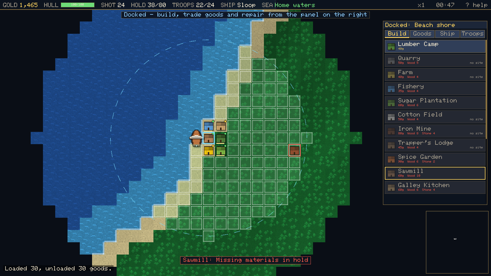
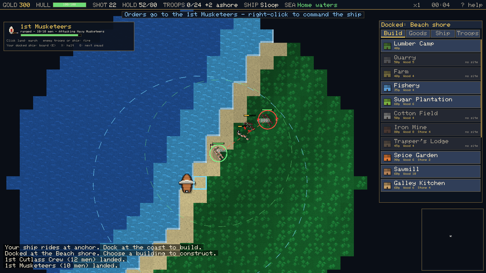
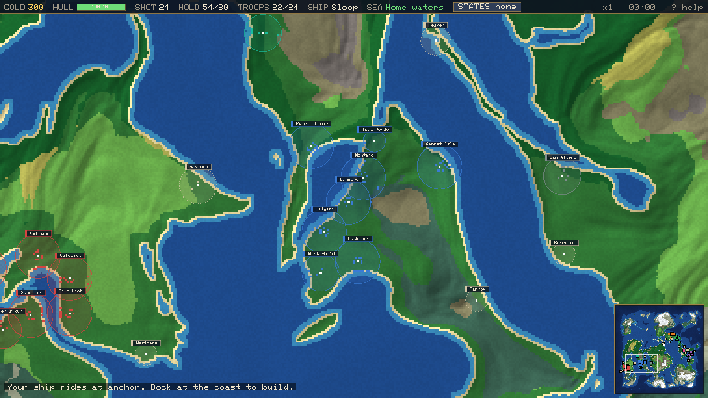
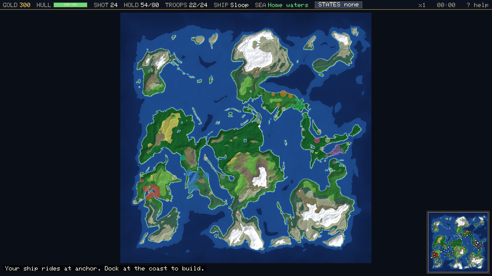
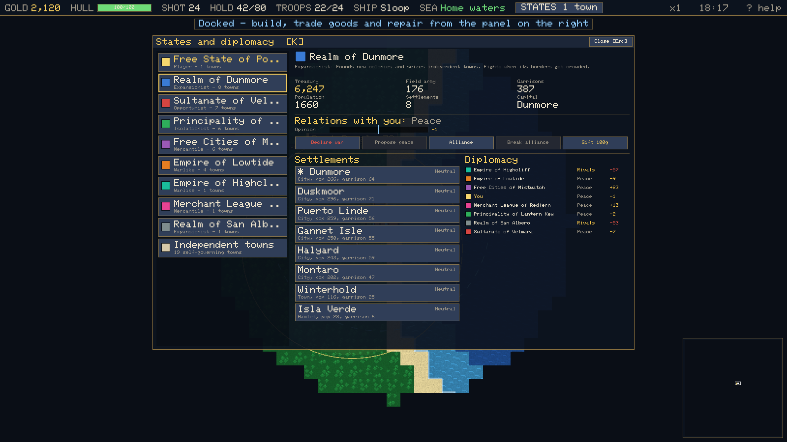
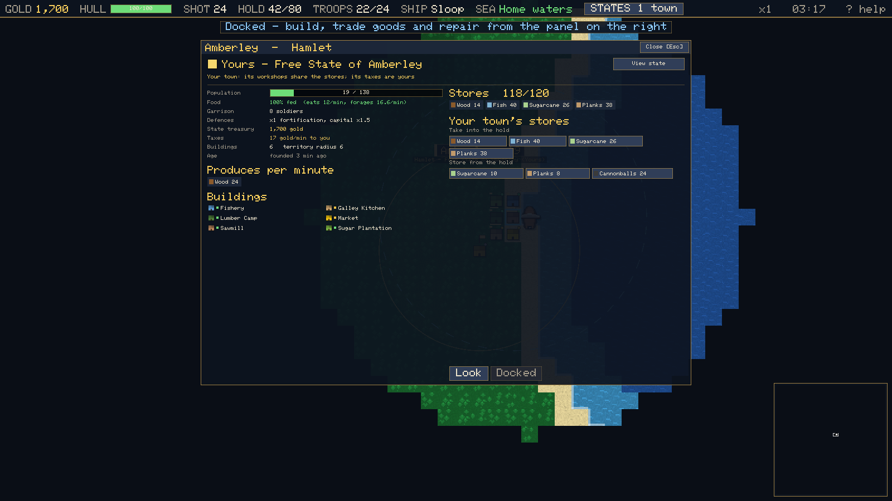
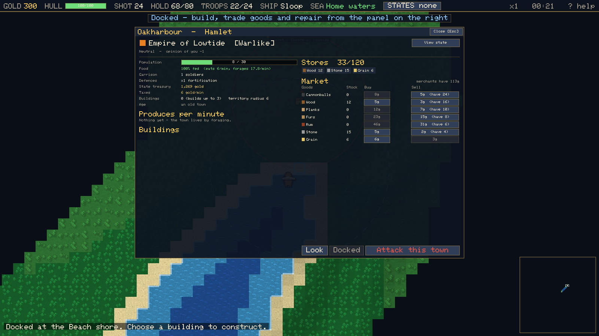

Disclaimer: This project (including this readme) is entirely vibecoded.


# Pirate Engine

A MonoGame engine for a single-player, top-down pirate game on a large procedurally generated
tile map (1024×1024 by default, up to 4096×4096). You sail a one-tile ship in real time with
click-to-move, dock at islands, build production buildings suited to each biome, ferry goods
between them by ship to complete production chains, and fight AI-controlled Navy and merchant
ships with broadside gunnery. Your ship also carries squads of troops: land them when docked
and march them across the island to fight Navy garrisons, with musketeers able to fire on
ships within range of the shore.

You arrive in an **established world**: computer-run **states** with old capitals, cities and
long-standing alliances and rivalries, crowded heartlands, a thinly settled frontier, and
independent towns — all configured in `setup.json`. The world is near equilibrium: it changes
slowly on its own and reacts mainly to you. Trade with its towns, ally with its realms, conquer
them, or build a **Town Hall** to found a settlement and state of your own.







## Quick start

Requires the .NET 8 SDK (or newer).

```bash
dotnet run --project src/PirateEngine.Game -c Release
dotnet run --project src/PirateEngine.Game -c Release -- --seed 1337 --size 2048
```

The first build restores `MonoGame.Framework.DesktopGL` from NuGet. There is no content
pipeline step: every texture (tiles, ships, buildings, font) is generated procedurally at startup.

Run the test suite (no packages needed):

```bash
dotnet run --project tests/PirateEngine.Tests -c Release
```

### Command line

| Option | Meaning |
|---|---|
| `--seed N` | World seed (default random) |
| `--size N` | Map width and height in tiles, 256–4096 (default 1024) |
| `--load FILE` | Load a save file |
| `--setup ID` | Starting world preset from `setup.json`: `standard` (default), `frontier`, `crowded`, `charted`, `empty` |
| `--scenario NAME` | Demo setup: `overview`, `harbour`, `goods`, `battle`, `voyage`, `landing`, `troops`, `realms`, `town`, `colony`, `market`, `states` |
| `--screenshot FILE --frames N` | Save a PNG after N frames, then exit |
| `--window WxH` | Initial window size |

## Controls

| Input | Action |
|---|---|
| Left-click water | Set sail (pathfinds around land) |
| Left-click land | Sail to the nearest reachable coast and dock |
| Left-click a ship | Attack — your ship closes to range and circles to bring its broadside to bear |
| Left-click enemy troops | Bombard them from the ship (cannon does double damage to troops) |
| Left-click your squad | Select it — further clicks order the squad instead of the ship |
| …then left-click | Land: march there · enemy troops: attack · a ship: fire on it (musketeers) · your docked ship: board |
| `U` / `E` / `Q` / `X` | Land all troops (docked) / board selected squad / select next squad / halt |
| Right-click | Cancel building placement, else deselect squad, else drop anchor |
| Mouse wheel, `+`/`-` | Zoom (zoom out to see the whole world) |
| WASD / arrows, middle-drag | Pan camera (Shift for faster); `F` / `Home` to follow the ship |
| Space, `1`–`4` | Pause; game speed ×1 ×2 ×4 ×8 |
| `T` / `R` | Auto-transfer goods / repair hull (while docked) |
| `Tab` | Toggle hold panel |
| `K` / `L` | States & diplomacy screen / settlement screen of the nearest town |
| Click a town's name plate or town hall | Settlement screen (also from the States screen and the Goods tab) |
| `F5` / `F9` | Quick save / quick load |
| `F3` / `F4` / `G` | Debug overlay / toggle fog of war / tile grid |
| `F12`, `Esc`, `H` | Screenshot, pause menu, help |

Minimap: left-drag to look around, right-click to set sail.

## How the game plays

1. **Explore.** The map is hidden under fog of war until your ship sees it.
2. **Dock.** Click any land; the ship sails to the nearest coast on that island. While docked
   you can build within `dockReach` (8 tiles) of the dock, on the same island.
3. **Build.** Each building has allowed biomes (a Lumber Camp needs forest, jungle, taiga or swamp;
   a Mine needs hills or mountains; a Fishery must be on the coast). Costs come from your gold
   and the materials in your hold.
4. **Run production chains by ship.** Buildings have an input store and an output store. Load
   outputs into the hold, sail them anywhere, and unload them into buildings that need them —
   per resource in the Goods tab, or everything at once with *Auto transfer* (`T`).
5. **Fight.** Navy ships patrol, chase you on sight and fire broadsides. Merchants are neutral
   until you attack them. Sunk ships leave wreckage — sail over it to salvage gold and cargo.
   Firing costs cannonballs from your hold (made by a Foundry); repairs cost planks.
6. **Take troops ashore.** You start with a Cutlass Crew and a squad of Musketeers aboard. While
   docked, land them from the **Troops** tab (or `U`); each appears on the shore as one entity — a
   formation of its soldiers — and moves in real time like the ship, but over land, slowed by
   rough terrain. Navy garrisons guard posts on islands away from home. March squads back to the
   docked ship to re-board; recruit more at a Barracks (gold plus rations, and iron for muskets).
7. **Grow.** Build a Shipyard to refit Sloop → Brigantine → Frigate, which also carry more troops.
   Danger rises with distance from the start harbour, which is a refuge the Navy won't pursue you into.
8. **Found a state, or take one.** Build a Town Hall on unclaimed land to found a settlement — your
   nearby outposts join it, its workshops feed each other through the town stores, it grows and pays
   you taxes, and you become a state other realms deal with. Trade at foreign towns, make allies, or
   land troops, beat a town's militia and hold its town hall to conquer it.

### States and settlements




**Settlements** are founded by a Town Hall. Each has a population, a garrison, a merchants' purse
and a shared store, and a territory around its hall (6–12 tiles by level) in which only its owner
may build. Every town is a port on the open sea.

- **Their economy runs itself.** Every 10 s a town moves its workshops' outputs into the stores and
  hands inputs back out (no ship needed inside a town), eats food (foraged from fertile land nearby,
  plus grain, fish and rations from the stores), pays taxes to its owner, keeps its garrison up
  (faster with a Barracks) and ships surplus goods away so its stores never clog.
- **Levels:** Hamlet → Village → Town → City, by population, each with a bigger territory, storage,
  building limit and fortifications.
- **Ownership** is a state, the player, or nobody: **independent** towns govern themselves, trade
  with everyone and defend themselves against whoever attacks them.
- **Your town** is founded by placing a Town Hall (250 gold, 10 planks, 8 stone) at least 20 tiles
  from other towns; buildings inside its territory join it automatically. Taxes, market income and
  customs go to your gold. Load from and add to its stores from the settlement screen when docked.
- **Foreign towns** have a market: buy from their stores and sell from your hold. Prices follow
  scarcity; mercantile owners pay best; the merchants' purse limits what they can buy. Trading
  improves the owner's opinion of you.

#### The starting world (`setup.json`)

A new game is populated from a **preset** in `setup.json` (pick one with `--setup ID`):

| Preset | World |
|---|---|
| `standard` | 4 heartlands; 2 great realms, 3 regional powers, 3 minor states; ~16 independent towns and 2 free cities; a friendly harbour village by your start |
| `frontier` | 2 heartlands, a handful of realms, scattered villages and wide empty coasts |
| `crowded` | "Old World": 6 heartlands packed with cities, city-states between them, and one old war still running |
| `charted` | Three named, hand-placed realms (a worked example to copy) plus generated minor states and towns |
| `empty` | No states or towns: build your own from nothing |

How a preset becomes a world:

1. **Density.** A few **heartlands** — the richest stretches of fertile coast, kept away from your
   start — are the centres of civilisation. Settlement density is high in their cores, fades through
   a sparsely settled **frontier**, and drops to empty **wilderness** (with a little noise so it's
   not perfectly round). Town spacing follows density, from `spacing.dense` to `spacing.sparse`.
2. **States** are listed by size class (`major`, `regional`, `minor`, `citystate`, or your own), each
   with a town count, realm radius, capital level and town levels. Great realms take a heartland
   each (extra ones share a heartland with a rival neighbour); minor states sit in the frontier. A
   state can also be **hand-designed**: name, capital name, behaviour, colour and position (`at`,
   as fractions of the map) — a hand-placed great realm brings its own heartland.
3. **Realms** claim towns within their radius, nearer their own capital than anyone else's, taking
   turns so neighbours share contested land. **Free cities** fill gaps between realms; independent
   towns scatter by density. A **start port** puts a friendly independent harbour near you.
4. **Every town is established** at its level: a population near (not at) what its buildings support
   (`fill`), buildings chosen for its land — enough food first, then raw materials, workshops for
   what it makes, markets and barracks — stocked stores, a full garrison and merchants' purse.
   Towns are "old" (founded long before you arrived). States start with treasuries and armies at
   their natural strength.
5. **History:** every pair of realms gets a *natural opinion* from their characters and borders;
   the worst-matched neighbours become old **rivals**, the best-matched peaceable ones **allies**, and
   a preset can start some rivalries as wars already under way.

Counts scale with map area, so a preset suits any map size (on a 1024² map the standard preset
gives ~55 towns in 8 states; on 2048², ~19 states).

#### A world in equilibrium that reacts to you

The world doesn't race ahead on its own. Tuning lives in `config.json` → `politics`:

- **Slow growth.** A fed town closes 0.2% of the gap to its population cap every 10 s, so it
  takes hours, not minutes, to grow; a computer-run town only builds when it's crowded or short of
  food (a few times per hour across a whole realm). Your own towns grow twice as fast, since they
  start small. Prosperous realms at peace found a new colony now and then — a handful per playthrough
  hour across the world.
- **Opinions settle.** Gifts, trade, wars, shared enemies and conquests push opinions about, and
  they drift back toward each pair's natural level.
- **Rare unprovoked wars.** A state with an appetite for war (its *war score* — aggression,
  opinion, relative strength, distance — above 40) acts on it only with a small chance per
  diplomacy tick, never during its cool-down after a war (and every realm starts the game settled).
  Wars end with weariness, losses, or the attacker taking its prize, followed by a 30-minute truce.
  Sieges grind on for minutes and armies regroup between campaigns.
- **Reasons change that:** a state acts readily against **a player who has provoked it** (opinion
  −40 or lower), against **a rising power** (anyone — you included — grown well beyond their starting
  size; for you, four towns), and opportunists circle **a realm already losing towns** in another war.
- **The world takes sides.** When you declare war, the target's allies join it, its friends resent
  you and its rivals and enemies warm to you. When you conquer a town, nearby realms grow wary (the
  more peaceable, the more so), the loser's allies resent it and its enemies approve.

In a 40-minute test with no player input on the standard preset, no wars start, no town changes
hands and total population grows about 7%; over five simulated hours a few short wars break
out, a few independent towns are absorbed and a few colonies founded.

**States** have a treasury, a field army, settlements (one is the capital) and a **behaviour**:

| Behaviour | Character |
|---|---|
| Warlike | Spends heavily on armies, picks fights with weaker neighbours, rarely sues for peace |
| Expansionist | Founds colonies and seizes independent towns; fights when borders get crowded |
| Mercantile | Rich from trade; prefers peace and alliances; pays well for goods |
| Isolationist | Keeps to itself behind strong garrisons; never starts wars, defends fiercely |
| Opportunist | Strikes the weak or those already losing a war, makes peace once it has its prize |

Behaviours are weight sets (aggression, expansion, trade, defence, peacefulness, opportunism) in
`config.json`, so new ones need no code. They drive war scores and peace willingness, alliances,
tax and trade, garrison size, army size, colonising and building. **Conquest**: a state at war sends
its field army to besiege the best target in reach. Far from you, sieges are resolved by numbers
(garrison × fortification × defence behaviour, capitals ×1.5); near you (80 tiles) they are fought
for real — garrisons muster as **militia squads** in the town's colours, and assaults on your towns
arrive as enemy squads that march on your town hall. Realms grown past 16 towns tire of war
faster and may lose distant towns to independence. A newly founded player state gets a 10-minute
grace period.

**Conquering a town yourself:** open its settlement screen and press *Attack* (this declares war
on its owner, or makes an independent town hostile), land troops, defeat the militia, and hold the
town hall with no defenders left for 12 s. It becomes yours — and founds your state if you had none.
Attacking a state's troops also means war.

The **settlement screen** shows owner, level, population, food, garrison, fortification, treasury,
taxes, siege or occupation progress, what it produces per minute, its buildings and stores, plus the
market or your own stores and the *Sail here* and *Attack* actions. The **States screen** (`K`) lists
every realm and the independent towns; for each state it shows behaviour, treasury, army,
population, settlements (click to open), its relations with every other realm (old rivals and old
friends marked), its opinion of you with its natural level, and your diplomatic
actions — declare war, propose peace, propose an alliance, break an alliance, send a gift — and
any offers of peace or alliance waiting for your answer.

### Land units

| | Cutlass Crew (melee) | Musketeers (ranged) |
|---|---|---|
| Squad | 12 men × 10 hp | 10 men × 8 hp |
| Attack | 2 per man per blow, every 1.2 s, in contact | one ball per man every 3.5 s, range 5.5; 4 damage on troops, 2 on a hull |
| Targets | troops only | troops and ships |
| Speed | 2.4 tiles/s on open ground | 2.1 tiles/s |
| Recruit | 60 gold + 4 rations | 90 gold + 4 rations + 2 iron |

- **A squad is one entity with a shared hit-point pool.** Its head-count is derived from that pool,
  so casualties visibly thin the formation and reduce its damage.
- **Movement mirrors ships.** Squads pathfind over land (A* in a land domain with terrain costs:
  forest 1.35×, jungle 1.7×, swamp 1.9×, hills 1.5×, snow 2×, mountains 2.6×), move continuously,
  and can't enter water. Ordering a squad onto the sea or another island sends it to the nearest
  reachable spot, or tells you to ferry it by ship.
- **Aboard ships**, squads aren't on the map; they take troop-deck places (Sloop 24, Brigantine 48,
  Frigate 80). They land next to the dock and board from within 1.8 tiles of the docked ship. If the
  ship sails off while a squad is walking back, the order is cancelled. If the ship sinks, the
  troops aboard are lost with it.
- **Combat.** Ranged squads fire musket volleys (real projectiles with angular and range error) at
  troops or ships in range; melee squads strike troops in contact. Idle player squads defend
  themselves against troops that come close. Ships fire on hostile troops within the broadside arc;
  Navy ships defend the shore against your squads.
- **Navy garrisons** spawn ashore around the player (never in the safe harbour or next to your
  buildings), drill around their post, engage intruders within 7 tiles and give up beyond a
  14-tile leash. Defeating one pays loot.

Shipped production chains:

```
wood ─► Sawmill ─► planks ─────────────────────────► repairs, refits, buildings
iron ore + wood ─► Smelter ─► iron ─► Foundry ─► cannonballs (ammunition)
cotton ─► Weaver ─► cloth ─► Sailmaker ─► sails ─► ship refits
sugarcane ─► Distillery ─► rum ─┐
grain + fish ─► Galley ─► rations ┼─► Market ─► gold
furs, spices, cloth ─────────────┘
```

## Architecture

```
src/PirateEngine.Core     Simulation library. No MonoGame dependency: runs headless, fully unit-tested.
  World/                  TileMap (flat arrays), WorldGenerator, Noise, Biome table, FogOfWar
  Navigation/             Pathfinder (A* over a water or land domain), PathWorker (background thread)
  Data/                   Definitions + DefinitionDatabase; resources/buildings/ships/units/config .json
  Economy/                Inventory, Building (production state machine)
  Entities/               MobileEntity (base for anything that moves), Ship, LandUnit, Projectile, Wreck
  Combat/                 CombatSystem (broadsides, musket volleys, melee, ballistics, damage)
  AI/                     ShipBrain (Hunter, Merchant), UnitBrain (Garrison, Assault), Steering, UnitSteering, SpawnDirector
  Politics/               State, Settlement, Diplomacy; PoliticsSystem (economy, diplomacy, military, trade, setup, saves)
  Data/setup.json         Starting-world presets (WorldSetupDefs.cs)
  Simulation/             GameWorld (root + command API), MovementSystem, GameEvents
  Persistence/            SaveData (JSON)
src/PirateEngine.Game     MonoGame shell: rendering, UI, input
  Rendering/              Camera2D, WorldRenderer (two LODs), EntityRenderer, TileArt, SpriteArt, BitmapFont
  UI/                     UiContext (immediate-mode), Hud (+ settlement / states screens, town name plates)
  Input/                  InputState, PlayerController
tests/PirateEngine.Tests  77 tests incl. sea, land-campaign and 40-minute world-equilibrium soaks on a full-size map
tools/MonoGameShim        Headless software-rendered stand-in for CI (see below)
```

**Core is the engine; the MonoGame project is a client of it.** The input layer only calls
`GameWorld`'s command API (`CommandMoveTo`, `CommandDock`, `CommandAttack`, `PlaceBuilding`,
`LoadFromBuilding`, `UnloadToBuilding`, `AutoTransfer`, `Repair`, `UpgradeShip`, `Disembark`,
`CommandEmbark`, `CommandUnitMove`, `CommandUnitAttack`, `RecruitUnit`, and on `GameWorld.Politics`
`PlayerDeclareWar`, `PlayerProposePeace`, `PlayerGift`, `BuyFrom`, `SellTo`, `PlayerAttackSettlement`, …), and the
renderer only reads public state and `GameEvents`. That keeps all rules testable without a window
and would let you swap the renderer or run the simulation on a server.

### Designed for large maps

- **Tile storage** is structure-of-arrays (`Biome[]`, `float[] Elevation`, …), indexed `y*W+x`.
  Building occupancy is a sparse dictionary. Fog of war is a 1-bit-per-tile mask with per-chunk
  revision counters.
- **Rendering has two levels of detail.** Zoomed out, the world is baked into 256×256-tile chunk
  textures (1 texel per tile, hill-shaded) — the whole map is a handful of quads, and the minimap
  reuses the same textures. Zoomed in, only visible tiles are drawn with procedural tile art,
  animated water and shoreline foam. Chunks re-bake lazily when exploration changes them.
- **Pathfinding.** A* runs on a padded passability grid with generation-stamped buffers (no
  per-search clearing), octile heuristic, no diagonal corner-cutting, and string-pulling to straight
  legs. Unreachable goals (e.g. a landlocked lake) are rejected in O(1) via precomputed connected
  regions. Long trips use weighted A* and are planned on a **background thread**, so a click across
  the map never stalls a frame.
- **Simulation** runs in fixed 1/30 s steps independent of frame rate and time-scale; rendering
  interpolates between steps.
- **AI population is a bubble around the player**: ships spawn just outside sight and despawn far
  behind, so cost doesn't grow with map size. Spawn mix scales with distance from the start harbour.
- **The starting world** is built from candidate harbour sites found with one breadth-first pass
  over the coast, so setup costs about 0.1 s on a 1024² map (a few seconds on 4096²).
- **Politics runs at two levels of detail.** The whole world's states and towns tick slowly
  (economy every 10 s, diplomacy every 20 s, sieges every 3 s) as numbers; only towns within 80 tiles
  of you turn their garrisons and attackers into real squads. Forty minutes of world politics on a
  1024² map cost about 2 s of CPU in the soak test.

Measured in this repo's soak test on a 2-core machine (1024² map, 10 minutes of game time with
AI, combat and random long-distance orders, background pathing on): about **0.01 ms per simulation
step on average, worst step about 1 ms**. A 1024² world generates in about a second.

### Movement model

Ships and squads share one movement system through the `MobileEntity` base class. Each moves
continuously (not turn-based) along its path, always in a straight line toward its current
waypoint, and every leg is verified to stay in its own domain — ships can't be pushed ashore and
squads can't walk into the sea. Heading turns at a set rate and an entity slows when facing far off
course; for a ship this reads like a sailing ship coming about, without a physics model that could
drift onto land. Squads additionally move at 1/terrain-cost speed on each tile. Background
pathfinding, render interpolation, targeting and save data all work on the shared base.

## Extending the game (no code)

All content lives in JSON next to the executable (`Data/`), with embedded copies as fallback.
Every reference is validated at load time, so a typo fails with a clear message at startup.

Add a building — e.g. a Tannery that turns furs into leather — by adding the resource to
`resources.json` and the building to `buildings.json`:

```jsonc
{ "id": "tannery", "name": "Tannery", "glyph": "N", "color": "#8B5E3C",
  "allowedBiomes": ["Taiga", "Tundra", "Grassland"],
  "goldCost": 70, "buildCost": { "planks": 6 }, "storage": 30,
  "recipes": [ { "inputs": { "furs": 2 }, "outputs": { "leather": 1 }, "cycleSeconds": 10 } ] }
```

Recipes may also pay `goldOutput`; buildings may expose `services` (e.g. `"shipyard"`,
`"barracks"`). Ship classes (including `troopCapacity`), the upgrade path, the AI spawn tables for
ships and for garrisons (with danger bands, loot and cargo) and all tuning values (dock reach, ammo
use, broadside arc, spawn radii, starting troops…) are in `ships.json` and `config.json`.

Add a unit type in `units.json` — for example grenadiers that hit hard but slowly:

```jsonc
{ "id": "grenadiers", "name": "Grenadiers", "kind": "ranged",
  "description": "Hurl grenades a short distance.",
  "members": 8, "hpPerMember": 12, "damage": 9, "damageVsShips": 4, "range": 3.5, "reload": 5,
  "accuracy": 0.5, "speed": 1.9, "sightRadius": 7, "autoEngageRadius": 4,
  "recruitGold": 120, "recruitCost": { "rations": 4, "iron": 4 } }
```

It appears in the Barracks recruit list automatically; add it to `unitSpawns` in `config.json`
to give the Navy some too.

Which states and towns exist at the start — presets, density, size classes, hand-designed realms,
independents, the start port and starting relations — is in `setup.json` (see *The starting world*
above; every field is commented). A hand-designed realm is one line:

```jsonc
{ "name": "Crown of Valemont", "capital": "Valemont", "behaviour": "expansionist",
  "size": "major", "color": "#9B59B6", "at": [0.32, 0.38] }
```

How the world behaves afterwards is tuned in the `politics` section of `config.json`: growth,
construction, colonisation and war chances, war cool-down, campaign pauses, how fast opinions
settle, taxes, garrison and army sizes, capture time, truce and grace periods, the settlement levels (population threshold, territory radius, building
cap, storage, fortification), behaviours (weights, description, realm titles such as
`"Sultanate of {0}"`), town names and realm colours. The Town Hall is an ordinary building in
`buildings.json` with the `"town_hall"` service, so its cost and art are data too; resources carry a
trade `value` and a `food` value.

Engine extension points in code: new `ShipBrain` / `UnitBrain` subclasses for AI, `GameEvents`
for audio or achievements (including `WarDeclared`, `PeaceMade`, `AllianceFormed`,
`SettlementFounded`, `SettlementCaptured`, `SiegeStarted`, `StateCollapsed`), `Biomes.LandCost` for terrain movement costs, `Pathfinder.ExtraCost`
for terrain-weighted sailing, `GameWorld.SpawnAiShip` / `SpawnAiUnit` / `GrantGold` for scripted
events, and `DemoScenarios` as worked examples of the public API.

## Saves

`F5` writes `quicksave.json` under your local app-data folder (`%LOCALAPPDATA%\PirateEngine` on
Windows, `~/.local/share/PirateEngine` on Linux). The map is regenerated from its seed, so a save is
a few KB regardless of map size. Saves store content by id, survive content edits, and are written
atomically.

## Verification notes

The simulation (`PirateEngine.Core`) is covered by the test suite, which passes in full. Highlights:
world generation (determinism, land fraction, all 15 biomes, climate by latitude), pathfinding
(all-water legs, no corner-cutting, 20 000 segment checks cross-validated against brute force),
docking, every placement rule, a production chain run end-to-end by ship including between two
islands, market income, repairs and refits, combat to the sink, salvage, AI engagement and hit
rates, the harbour refuge, respawn, save/load round-trip, and two 10-minute full-map soaks with
invariant checks every step. Land units: landing only when docked, marching on land only with
terrain slowing them, no walking between islands, boarding (and cancellation when the ship
leaves), troop capacity, melee to a decision, casualties thinning squads, musketeers hitting ships,
melee unable to target ships, shore garrisons and ships exchanging fire, garrison guard / engage /
leash behaviour, recruitment, troops lost with a sinking ship, saves with squads ashore and aboard,
garrison spawn placement, and a 5-minute land-campaign soak. Politics: every
preset populating (states, independents, standing wars), the standard world starting established
(cities as capitals, towns fed, garrisoned, with buildings and near their population cap, all ports,
capitals clear of the start, a start port in range), dense clusters and a sparse frontier,
hand-designed states placed and named as specified, a preset written in JSON (and bad references
rejected at load), a 40-minute equilibrium soak (no collapses, the map barely changes hands,
slow growth, towns stay fed), towns still growing over an hour, unprovoked wars being rare,
provocation overriding the quiet times, the world taking sides when you declare war, conquest
alarming neighbours, a rising player power drawing attention, logistics, starvation, founding your
settlement and state, taxes, the grace period, behaviour driving war decisions, allies joining wars,
abstract sieges, player diplomacy, militia, capturing a town with your squads, AI assaults arriving
as real squads, trade, and save/load of the whole political map.

The MonoGame project was built and screenshotted in an environment **without NuGet access or a
GPU**, using `tools/MonoGameShim`: an API-compatible stand-in for the parts of MonoGame this game
uses, with a software `SpriteBatch`. The screenshots in `docs/screenshots` are real frames from the
game code rendered that way. It has **not** yet been compiled against the real
`MonoGame.Framework.DesktopGL` package or run on a GPU, so treat the first real build as the final
check; the APIs used are standard MonoGame 3.8 ones.

To use the shim yourself (e.g. for CI screenshots):

```bash
dotnet build src/PirateEngine.Game -c Release -p:UseMonoGameShim=true
cd src/PirateEngine.Game/bin/Release/net8.0
SHIM_MAX_FRAMES=2000 dotnet PirateEngine.dll --scenario battle --screenshot battle.png --frames 20
```

`SHIM_MOUSE=x,y` sets the cursor, and `SHIM_KEYS=H:300,Escape:400` presses keys on given frames.

## Known limitations and next steps

- Art, the font and UI are procedural placeholders, built so you can swap in real sprites
  (`TileArt`, `SpriteArt`) without touching the simulation. There's no audio yet — subscribe to
  `GameEvents` (`VolleyFired`, `ShipDamaged`, `ShipSunk`, `UnitDamaged`, `UnitKilled`, …) to add it.
- Squads are selected one at a time; box-selecting and ordering several at once would be a natural
  next UI step (the command API already works per squad). Squads don't yet attack buildings, and
  the Navy doesn't land troops of its own beyond garrisons.
- Buildings are one tile each; multi-tile footprints would need a footprint list in `BuildingDef`.
- Long paths are fast and off-thread, but for maps well beyond 4096² a hierarchical pathfinder
  (HPA*) would be the next step.
- AI ships outside the bubble around the player aren't simulated as ships; states' armies and
  sieges are abstract numbers until near you. State navies, merchant convoys between towns, and AI
  troop landings by sea would be natural next steps on top of the politics layer.
- States don't yet demand tribute, trade with each other explicitly, or fight over individual
  buildings; the settlement screen shows town-level production rather than a full economy graph.
- The starting-world preset is chosen on the command line (`--setup`); a new-game menu to pick
  presets and map size in the game itself would be the natural next UI step.
- Saving keeps the political map, sieges and offers, but militia and assault squads on the map are
  re-mustered rather than saved.
